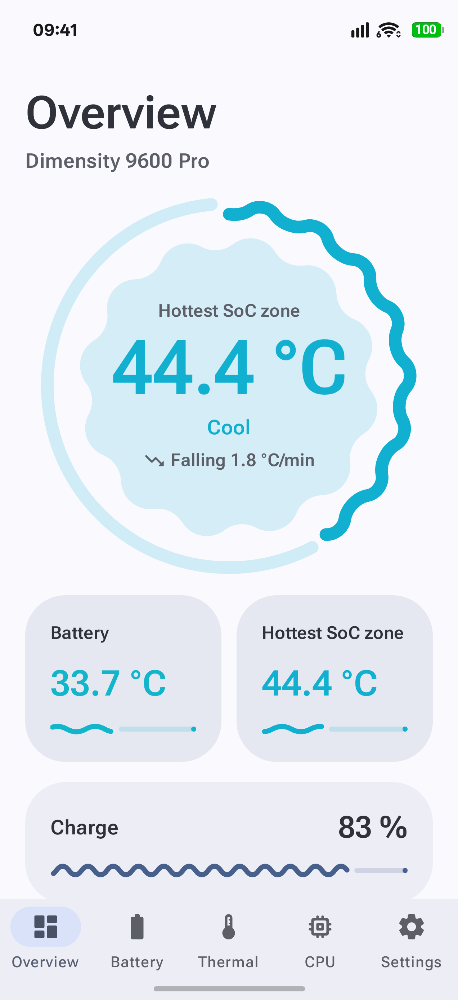
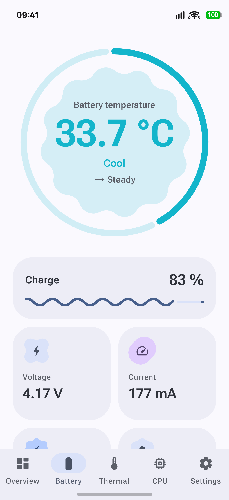
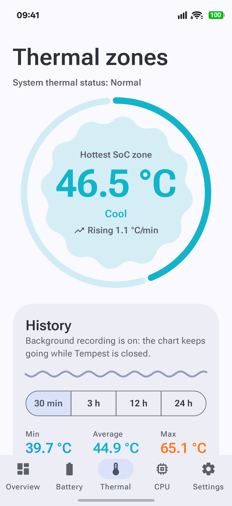
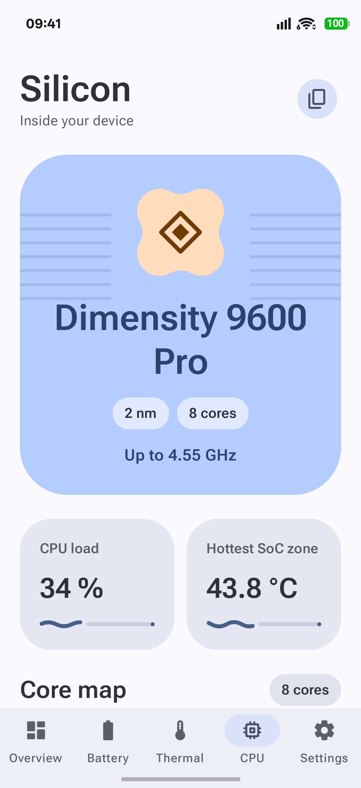
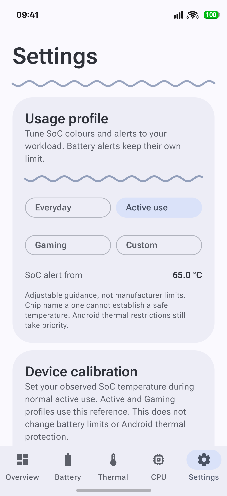

<p align="center">
  
</p>

<h1 align="center">Tempest</h1>

<p align="center">
  Ein welliges, expressives Thermometer für Akku und SoC deines Android-Handys.<br>
  <a href="README.md">English</a> · <b>Deutsch</b>
</p>

---

Tempest zeigt, wie warm dein Handy wirklich ist. Die Akkutemperatur sitzt in einer sich
verwandelnden Material-Form in einem welligen Ring, jede Thermal Zone des Kernels bekommt
ihren eigenen Wellenbalken, und die letzten 30 Minuten erscheinen als lebendige Welle, die
umso stärker schwingt, je heißer es wird. Gebaut mit Jetpack Compose und Material 3 Expressive.

## Screenshots

| Übersicht | Akku | Thermik | Chip | Einstellungen |
|:---:|:---:|:---:|:---:|:---:|
|  |  |  |  |  |

<sub>Auf einem OPPO CPH2913 aufgenommen. Die Statusleisten wurden für die Präsentation vereinheitlicht; die Messwerte der App sind unverändert.</sub>

## Funktionen

- **Übersicht** mit Akku- und SoC-Temperatur, Verlauf und Schnellzugriffen auf Sensoren
- **Neue Chip-Seite** mit auswählbaren CPU-Kernen, GPU-/RAM-Anzeigen und aufklappbaren Hardwaredetails
- **Darstellung nach Wunsch** mit Standard-Tab, Hell/Dunkel/System, dynamischen Farben, Wellen, Animationen und Haptik
- **SoC-Temperaturprofile** für Alltag, aktive Nutzung, Gaming und eigene Grenzen mit anpassbarer Normaltemperatur unter Last; die Profile sind Richtwerte, keine vom Hersteller bestätigten Grenzwerte

- **Akkutemperatur live** über `ACTION_BATTERY_CHANGED`, dazu Spannung, Strom, Ladestand,
  Ladestatus, Stromquelle und Zustand
- **Thermal Zones** aus `/sys/class/thermal/thermal_zone*`, die heißeste zuerst, jede mit
  einem Wellenbalken, dessen Amplitude und Wellenlänge der Temperatur folgen
- **Root optional**: Mit KernelSU, Magisk oder einem anderen `su` werden alle Zonen per
  `su -c` gelesen; ohne Root zeigt Tempest die Zonen, die Apps lesen dürfen
- **Verlauf über bis zu 24 Stunden** für Akku und heißeste SoC-Zone als animierte Sinuswelle, deren
  Amplitude und Frequenz mit der Temperatur steigen. Wähle 30 min, 3 h, 12 h oder 24 h, fahre mit dem
  Finger über die Kurve für jeden Messpunkt und sieh Min, Schnitt, Max und die Zeit über der Grenze
- **Hintergrund-Aufzeichnung** über Shizuku: Der Verlauf läuft weiter, wenn Tempest geschlossen ist,
  ohne Benachrichtigung und ohne Wakelocks (pausiert, solange das Handy schläft)
- **Restlaufzeit** beim Entladen, und Akkus mit zwei Zellen werden an der Spannung erkannt
- **Mehr Messwerte**: Leistung, Restladung, Ladezyklen (ab Android 14), Akkutechnologie,
  Zeit bis voll sowie ein Trend in °C pro Minute
- **Mehr Sensoren**: thermischer Spielraum, CPU-Takt je Kern, Kühlgeräte und die
  Umgebungssensoren des Handys (Umgebungstemperatur, Luftfeuchtigkeit, Luftdruck, Licht)
- **Eigene Temperaturstufen**: Lege fest, was kalt, kühl, warm, heiß und ultraheiß ist;
  Farben, Formen und Wellen richten sich danach
- **Einstellbare Warnschwellen** (Standard: 40 °C Akku, 60 °C SoC im ausgeglichenen Profil) mit Hinweis und
  haptischem Feedback beim Überschreiten
- **Große Hintergrund-Alarme**: optionale Überwachung mit Heads-up-Benachrichtigung in
  riesiger Schrift und, wenn erlaubt, Vollbild-Alarm auch auf dem Sperrbildschirm
- **CPU-Tab** im Stil von CPU-Z: Chipname mit flachem Emblem je Hersteller (Snapdragon,
  Dimensity, Exynos, Tensor, Kirin, Unisoc), Live-Takt jedes Kerns, Cluster mit Kerntypen
  (Cortex-X4, Cortex-A720 …), Governor, GPU-Renderer mit OpenGL-ES- und Vulkan-Version,
  GPU-Auslastung und -Takt wo der Treiber es erlaubt, RAM, Swap, Speicherplatz, Display und System
- **Sensoren-Tab**: alle Sensoren des Handys mit Live-Werten, kleinem Live-Graphen, Filtern
  (Bewegung, Position, Umgebung) und komplettem Datenblatt per Antippen
- **Mehr bei Alarmen**: Test-Alarm, Erinnerung alle 2, 5 oder 10 Minuten solange es heiß bleibt,
  und Vorlagen (Standard, Gaming, Vorsichtig) für die Temperaturstufen
- **Schnelleinstellungs-Kachel**, **°C oder °F** und **CSV-Export** des Verlaufs
- **Material 3 Expressive**: `MaterialShapes` mit Shape-Morphing (Cookie, Sunny, Pill, Burst),
  `CircularWavyProgressIndicator` und `LinearWavyProgressIndicator`, Federanimationen mit
  `MotionScheme.expressive()`, variable Schrift Roboto Flex, die mit der Hitze kräftiger wird,
  Farbskala von kühlem Blau bis heißem Rot, Dynamic Color, dunkles Design, Edge-to-Edge
- **Shizuku-Unterstützung**: ohne Root. Über Shizuku liest Tempest zusätzlich CPU- und GPU-Last, die
  benannten Sensoren des Thermal-HAL (Skin, Modem, NPU …), hwmon-Chips, Ladegerät-Temperaturen,
  Akku-Kapazitätszustand und Ladelimits
- **Chip-Namen**: große eingebaute Liste (auch Dimensity 9600 Pro, `MT6995`) und eine optionale
  Wikipedia-Suche für unbekannte Chips (MediaTek und Qualcomm)
- **Privat**: nichts über dein Gerät verlässt es. Die Internetberechtigung nutzt nur die optionale,
  standardmäßig ausgeschaltete Chip-Suche, die eine öffentliche Chipliste lädt und lokal abgleicht

## Sprachen

Englisch (Standard), Deutsch, Französisch und Italienisch. Tempest folgt der Systemsprache.
Eine andere Sprache wählst du in den App-Einstellungen oder im App-Sprachmenü von Android
(ab Android 13).

## Bauen

Voraussetzungen: JDK 17 und das Android SDK (Compile SDK 37).

```bash
git clone https://github.com/david-x3d/tempest.git
cd tempest
./gradlew assembleDebug
```

Die APK liegt danach in `app/build/outputs/apk/debug/`. Jeder Push auf `main` baut sie auch
per GitHub Actions. Du findest sie im Bereich **Artifacts** des jeweiligen Laufs.

Mindestens Android 12 (API 31).

## Shizuku (optional)

Installiere [Shizuku](https://shizuku.rikka.app/), starte es, aktiviere **Einstellungen → Shizuku-Zugriff**
und erlaube Tempest. Die Befehle laufen nur lesend über einen kleinen Shizuku-Dienst. Shizuku hat
Vorrang vor Root, wenn beides an ist.

Die **Hintergrund-Aufzeichnung** (Einstellungen → Hintergrund-Aufzeichnung) startet einen zweiten, sehr
kleinen Shizuku-Dienst, der alle 30 s bis 5 min Akku- und SoC-Temperatur misst und die letzten 24 Stunden
in `/data/local/tmp/tempest/history.csv` hält. Beim Öffnen übernimmt Tempest sie in die Kurve. Ohne Root
endet Shizuku beim Neustart; danach Shizuku wieder starten, dann läuft die Aufzeichnung weiter.

## Root (optional)

Root ist nie nötig. Schalte **Einstellungen → Root-Zugriff** ein und bestätige die Anfrage
deines Root-Managers. Tempest führt dann pro Aktualisierung eine einzige lesende
Shell-Schleife aus (`cat /sys/class/thermal/thermal_zone*/type` und `.../temp`) und sonst
nichts. Wird Root verweigert, zeigt Tempest die ohne Root lesbaren Zonen.

## Architektur

MVVM mit Kotlin Coroutines: Repositories liefern `StateFlow`s (Akku, Thermal Zones,
Einstellungen in DataStore, Verlauf im Speicher), je Screen kombiniert ein `ViewModel` sie
zu einem UI-State, und Compose stellt ihn dar.

```
data/      battery · thermal (inkl. RootShell) · device · sensors · history · settings
ui/        battery · thermal · cpu · sensors · settings · components · theme
```

## Lizenz

[MIT](LICENSE). Die enthaltene Schrift Roboto Flex steht unter der
[SIL Open Font License 1.1](third_party/roboto-flex/OFL.txt).
