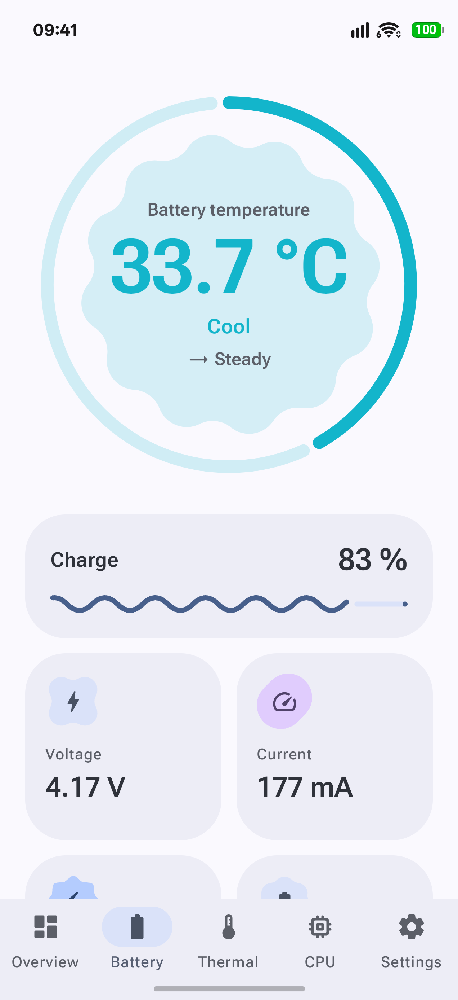
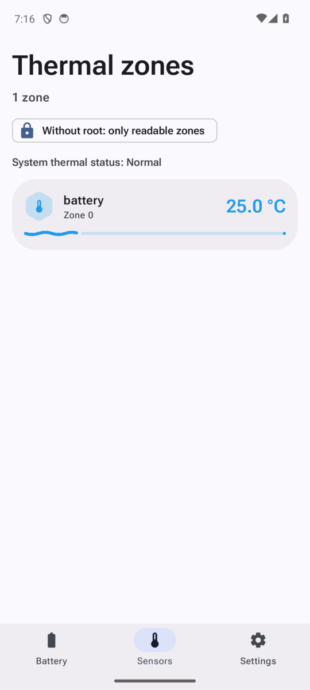
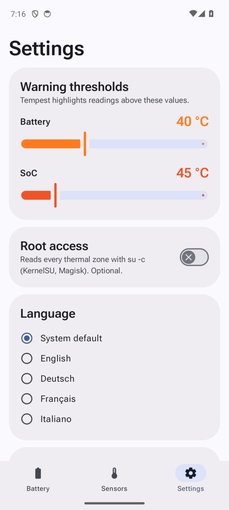

<p align="center">
  
</p>

<h1 align="center">Tempest</h1>

<p align="center">
  A wavy, expressive thermometer for your Android phone's battery and SoC.<br>
  <b>English</b> · <a href="README.de.md">Deutsch</a>
</p>

---

Tempest shows how warm your phone really is. The battery temperature sits in a morphing
Material shape inside a wavy gauge, every thermal zone the kernel exposes gets its own wavy
bar, and the last 30 minutes are drawn as a living wave that ripples harder the hotter it gets.
Built with Jetpack Compose and Material 3 Expressive.

## Screenshots

| Battery | Sensors | Settings |
|:---:|:---:|:---:|
|  |  |  |

<sub>Taken on the Android emulator, so the thermal page only shows the emulator's single zone.</sub>

## Features

- **Live battery temperature** from `ACTION_BATTERY_CHANGED`, plus voltage, current,
  charge level, charging state, power source and health
- **Thermal zones** from `/sys/class/thermal/thermal_zone*`, sorted hottest first, each with a
  wavy bar whose amplitude and wavelength follow the temperature
- **Optional root**: with KernelSU, Magisk or any `su`, every zone is read via `su -c`;
  without root Tempest lists the zones the system lets apps read
- **30-minute history** for battery and the hottest SoC zone, drawn as an animated sine wave
  whose amplitude and frequency rise with the temperature
- **More readings**: power, remaining charge, charge cycles (Android 14+), battery technology,
  time to full, plus a rising/falling trend in °C per minute
- **More sensors**: thermal headroom forecast, CPU core clocks, cooling devices and the phone's
  environment sensors (ambient temperature, humidity, air pressure, light)
- **Your own heat levels**: decide what counts as cold, cool, warm, hot and ultra hot; colours,
  shapes and waves follow them
- **Warning thresholds** you can adjust (defaults: 40 °C battery, 45 °C SoC) with a banner and
  haptic feedback when they are crossed
- **Big background alerts**: optional monitoring that posts a heads-up notification with the
  temperature in huge type and, if allowed, a full-screen alert over the lock screen
- **CPU tab** in the spirit of CPU-Z: chip name with a flat emblem per maker (Snapdragon,
  Dimensity, Exynos, Tensor, Kirin, Unisoc), live clock of every core, clusters with core types
  (Cortex-X4, Cortex-A720 …), governor, GPU renderer with OpenGL ES and Vulkan versions, GPU load
  and clock where the driver allows it, RAM, swap, storage, display and system details
- **Sensors tab**: every sensor the phone has, with live values, a short live graph, filters
  (motion, position, environment) and the full datasheet on tap
- **Alert extras**: a test alert, reminders every 2, 5 or 10 minutes while it stays hot, and
  presets (default, gaming, careful) for the heat levels
- **Quick Settings tile**, **°C or °F**, and **CSV export** of the history
- **Material 3 Expressive**: `MaterialShapes` with shape morphing (Cookie, Sunny, Pill, Burst),
  `CircularWavyProgressIndicator` and `LinearWavyProgressIndicator`, `MotionScheme.expressive()`
  springs, variable Roboto Flex type that gets heavier as it heats up, cool-blue to hot-red
  colour scale, dynamic colour, dark theme, edge-to-edge
- **Shizuku support**: no root needed. Through Shizuku Tempest also reads CPU and GPU load, the thermal
  HAL's named sensors (skin, modem, NPU …), hwmon chips, charger temperatures, battery capacity
  health and charge limits
- **Chip names**: a large built-in list (including the Dimensity 9600 Pro, `MT6995`) plus an optional
  lookup on Wikipedia for chips it does not know (MediaTek and Qualcomm)
- **Private by design**: nothing about your device ever leaves it. The internet permission is only used
  by the optional, off-by-default chip lookup, which downloads a public chip list and matches it locally

## Languages

English (default), German, French and Italian. Tempest follows the system language. You can
pick another one in the app's settings or in Android's per-app language menu
(Android 13 and later).

## Build

Requirements: JDK 17 and the Android SDK (compile SDK 37).

```bash
git clone https://github.com/david-x3d/tempest.git
cd tempest
./gradlew assembleDebug
```

The APK ends up in `app/build/outputs/apk/debug/`. Every push to `main` also builds it on
GitHub Actions. Download it from the run's **Artifacts** section.

Minimum Android version: 12 (API 31).

## Shizuku (optional)

Install [Shizuku](https://shizuku.rikka.app/), start it, then turn on **Settings → Shizuku access** and
allow Tempest in the prompt. Commands run read-only through a small Shizuku user service. Shizuku wins
over root when both are on.

## Root (optional)

Root is never required. Turn on **Settings → Root access** and approve the prompt from your
root manager. Tempest then runs one read-only shell loop per refresh
(`cat /sys/class/thermal/thermal_zone*/type` and `.../temp`) and nothing else. If root is
denied, Tempest falls back to the zones it can read without it.

## Architecture

MVVM with Kotlin coroutines: repositories expose `StateFlow`s (battery, thermal zones,
settings in DataStore, in-memory history), one `ViewModel` per screen combines them into a UI
state, and Compose renders it.

```
data/      battery · thermal (incl. RootShell) · device · sensors · history · settings
ui/        battery · thermal · cpu · sensors · settings · components · theme
```

## License

[MIT](LICENSE). The bundled Roboto Flex font is licensed under the
[SIL Open Font License 1.1](third_party/roboto-flex/OFL.txt).
